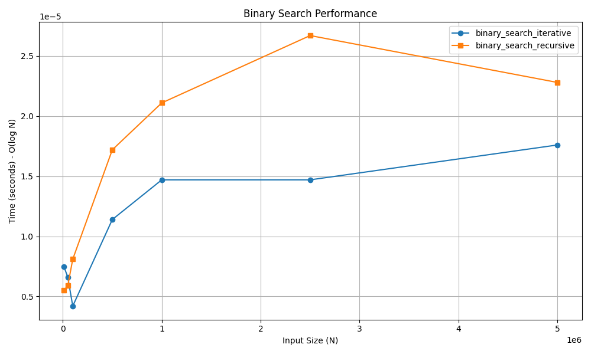

# Binary Search

## 📝 Problem Statement
The objective is to find the index of a target element within a **sorted** array. If the target element is not present, the algorithm should return `-1`.

## 💡 Algorithm / Approach
Binary Search uses a Divide and Conquer approach. Instead of scanning every element linearly, it compares the target value to the middle element of the array. If they are not equal, the half in which the target cannot lie is eliminated, and the search continues on the remaining half until the target is found.

## 📜 Pseudocode
```text
Procedure BinarySearch(arr, target)
    low = 0
    high = length(arr) - 1
    
    While low <= high
        mid = (low + high) / 2
        If arr[mid] == target Then
            Return mid
        Else If arr[mid] < target Then
            low = mid + 1
        Else
            high = mid - 1
        End If
    End While
    
    Return -1
End Procedure

```
