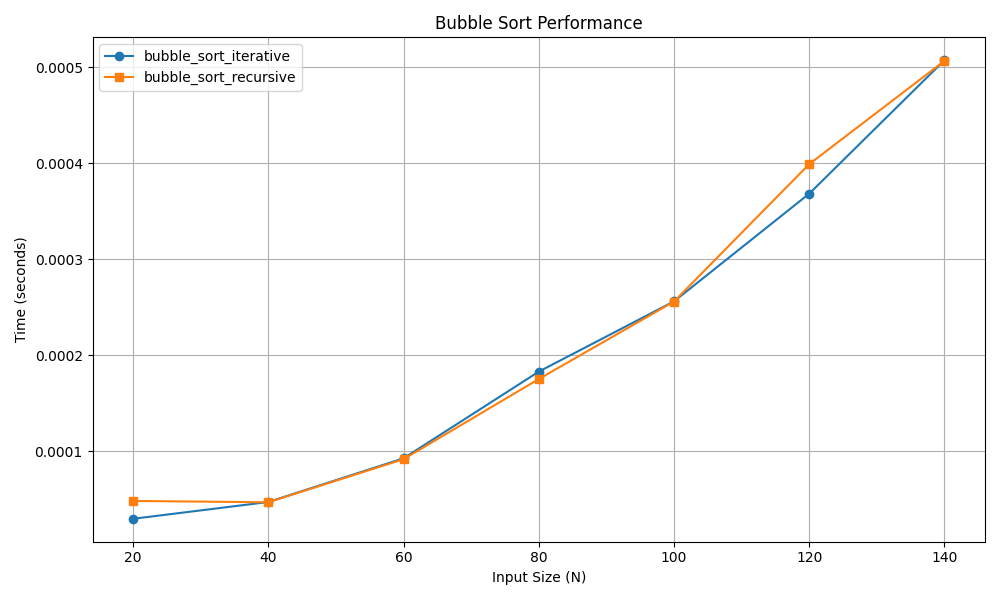

# Bubble Sort

## 📝 Problem Statement
The objective is to sort a given array of elements in ascending order. The algorithm must repeatedly step through the list, compare adjacent elements, and swap them if they are in the wrong order.

## 💡 Algorithm / Approach
Bubble Sort is a simple comparison-based sorting algorithm. 
* **Iterative Approach:** Uses nested loops. The outer loop runs $N$ times, and the inner loop pushes the largest unsorted element to its correct position at the end of the array.
* **Recursive Approach:** Instead of an outer loop, the function recursively calls itself for $N-1$ elements after placing the largest element at the end in the current pass.

## 📜 Pseudocode / Flowchart
```text
Procedure BubbleSort(arr, n)
    For i = 0 to n - 1
        For j = 0 to n - i - 2
            If arr[j] > arr[j + 1] Then
                Swap arr[j] and arr[j + 1]
            End If
        End For
    End For
End Procedure
```
