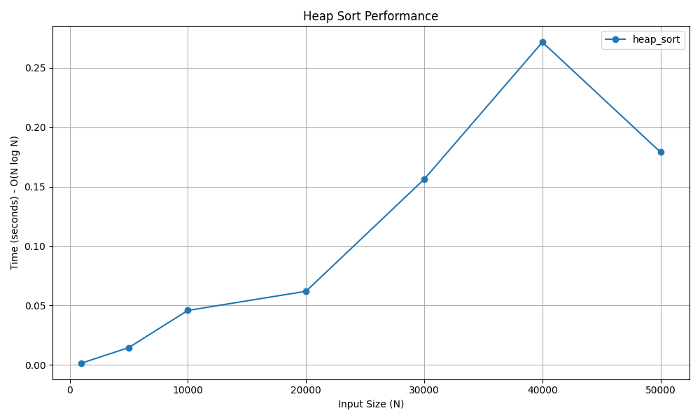

# Heap Sort & Min-Heap

## 📝 Problem Statement
1. **Min-Heap:** Construct a complete binary tree data structure where the value of each node is less than or equal to the values of its children.
2. **Heap Sort:** Sort an array in-place by converting it into a Max-Heap, then repeatedly extracting the maximum element to build a sorted sequence.

## 💡 Algorithm / Approach
* **Min-Heap (Data Structure):** Utilizes an array to represent a complete binary tree. The `insert` operation adds elements to the end and "bubbles up" to maintain the heap property. The `extract_min` operation removes the root, replaces it with the last element, and "bubbles down" (`heapify`).
* **Heap Sort (Algorithm):** Builds a Max-Heap from the unsorted array. It swaps the root (maximum value) with the last element, reduces the heap size by 1, and calls `heapify` on the new root to restore the Max-Heap property. This repeats until the array is sorted. the steps are as follows:-
  1. Build a Max-Heap from the input data.
  2. At this point, the largest item is stored at the root of the heap. Replace it with the last item of the heap followed by reducing the size of the heap by 1.
  3. Heapify the root of the tree to restore the Max-Heap property.
  4. Repeat steps 2 and 3 until the size of the heap is greater than 1. 

## 📜 Pseudocode
### Min-Heap Core Operations
```text
Procedure Insert(heap, key)
    Append key to end of heap
    i = length(heap) - 1
    While i != 0 and heap[Parent(i)] > heap[i]
        Swap heap[i] and heap[Parent(i)]
        i = Parent(i)
    End While
End Procedure

Procedure ExtractMin(heap)
    root = heap[0]
    heap[0] = last element in heap
    Remove last element
    Heapify(heap, 0)
    Return root
End Procedure

```
