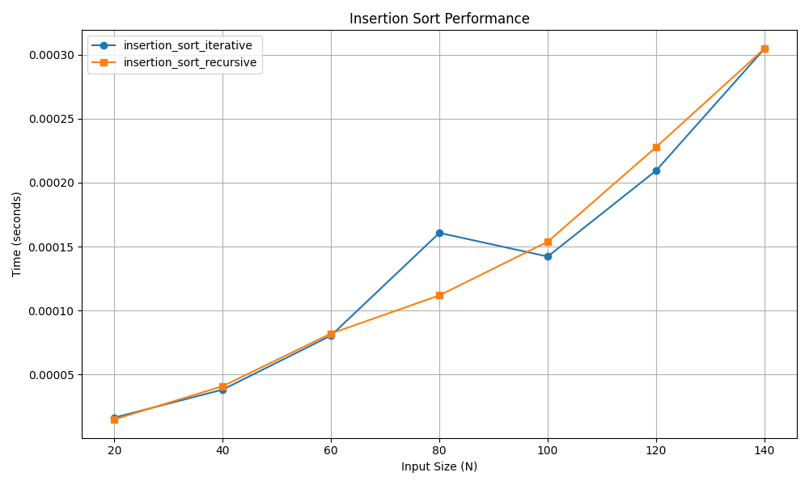

# Insertion Sort

## 📝 Problem Statement
The objective is to sort an array by virtually splitting it into a sorted and an unsorted part. Values from the unsorted part are picked and placed at the correct position in the sorted part.

## 💡 Algorithm / Approach
Insertion Sort iterates through the array, taking one element at a time and inserting it into its correct position within the already sorted portion of the array (the left side).
* **Iterative Approach:** Uses a `while` loop to shift elements that are greater than the key to one position ahead of their current position.
* **Recursive Approach:** Recursively sorts the first $N-1$ elements and then inserts the $N^{th}$ element into its correct spot.

## 📜 Pseudocode
```text
Procedure InsertionSort(arr, n)
    For i = 1 to n - 1
        key = arr[i]
        j = i - 1
        While j >= 0 and arr[j] > key
            arr[j + 1] = arr[j]
            j = j - 1
        End While
        arr[j + 1] = key
    End For
End Procedure

```
