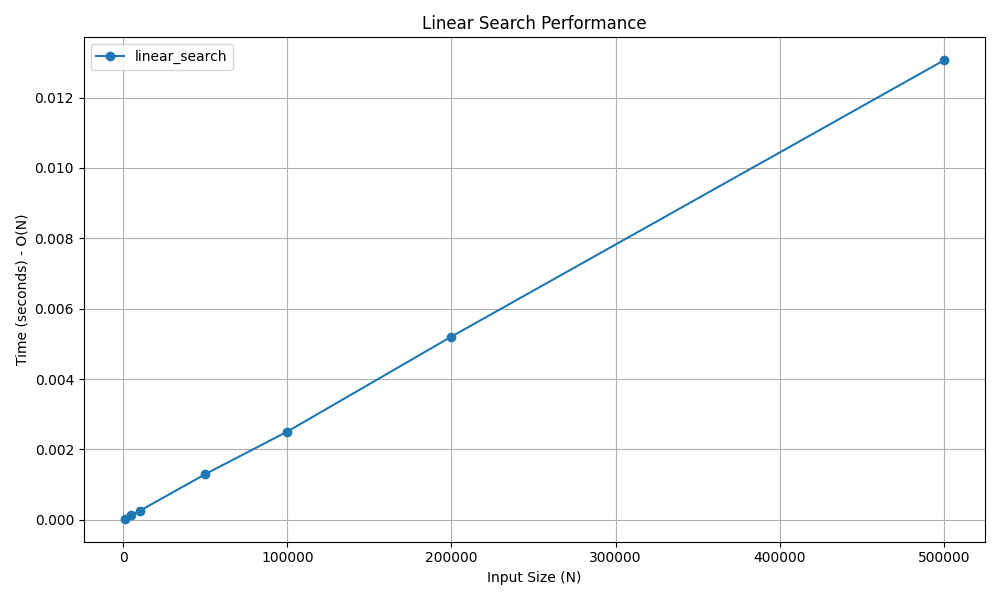

# Linear Search

## 📝 Problem Statement
The objective is to find the index of a target element within an array. If the target element is not present, the algorithm should return `-1`.

## 💡 Algorithm / Approach
Linear Search is the simplest searching algorithm. It sequentially checks each element of the array until a match is found or the entire array has been traversed. It does not require the array to be sorted beforehand.

## 📜 Pseudocode
```text
Procedure LinearSearch(arr, target)
    For i = 0 to length(arr) - 1
        If arr[i] == target Then
            Return i
        End If
    End For
    Return -1
End Procedure

```
