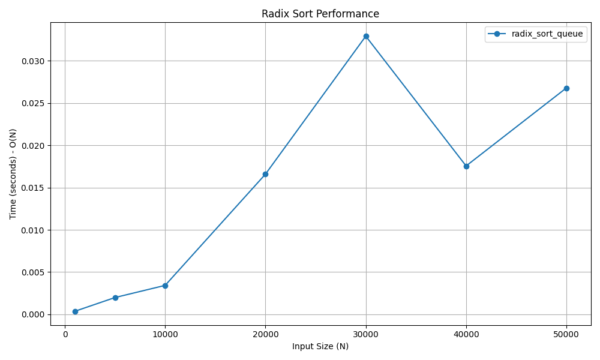

# Radix Sort (Queue-Based)

## 📝 Problem Statement
The objective is to sort an array of integers by processing individual digits. Radix sort groups numbers by each digit from least significant digit to most significant digit.

## 💡 Algorithm / Approach
Radix Sort is a non-comparison sorting algorithm. This implementation uses the Queue data structure to act as buckets for digits 0-9. 
1. Find the maximum number to know the number of digits.
2. For each digit position (ones, tens, hundreds), enqueue the numbers into 10 queues based on their digit value.
3. Dequeue the numbers back into the original array to maintain stable sorting order before moving to the next significant digit.

## 📜 Pseudocode
```text
Procedure RadixSortQueue(arr)
    max_val = FindMaximum(arr)
    exp = 1
    Initialize 10 empty queues (0 to 9)
    
    While max_val / exp > 0
        For each num in arr
            digit = (num / exp) % 10
            Enqueue num into queues[digit]
        End For
        
        idx = 0
        For each q in queues
            While q is not empty
                arr[idx] = Dequeue(q)
                idx = idx + 1
            End While
        End For
        
        exp = exp * 10
    End While
End Procedure

```
