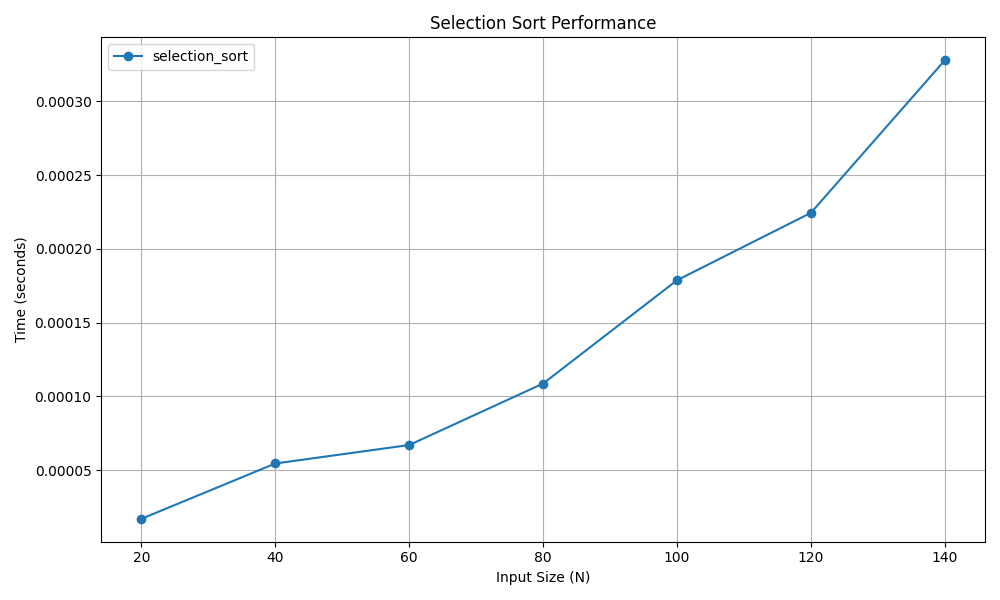

# Selection Sort

## 📝 Problem Statement
The objective is to sort an array by repeatedly finding the minimum element from the unsorted part and putting it at the beginning.

## 💡 Algorithm / Approach
Selection Sort divides the input list into two parts: a sorted sublist of items which is built up from left to right at the front (left) of the list and a sublist of the remaining unsorted items that occupy the rest of the list. It iterates through the unsorted sublist, finds the smallest element, and swaps it with the leftmost unsorted element.

## 📜 Pseudocode
```text
Procedure SelectionSort(arr, n)
    For i = 0 to n - 1
        min_idx = i
        For j = i + 1 to n
            If arr[j] < arr[min_idx] Then
                min_idx = j
            End If
        End For
        Swap arr[i] and arr[min_idx]
    End For
End Procedure
```
