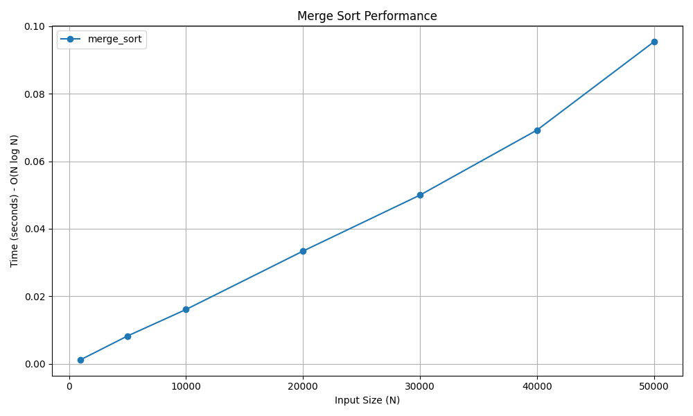

# Merge Sort

## 📝 Problem Statement
The objective is to sort an array of elements in ascending order efficiently using the Divide and Conquer algorithmic paradigm.

## 💡 Algorithm / Approach
Merge Sort recursively divides the input array in half until each sub-array contains only a single element (which is inherently sorted). It then repeatedly merges these sub-arrays back together in sorted order until the entire array is reconstructed.

## 📜 Pseudocode
```text
Procedure MergeSort(arr)
    If length(arr) <= 1 Then
        Return arr
    End If
    
    mid = length(arr) / 2
    left = MergeSort(arr[0 to mid-1])
    right = MergeSort(arr[mid to end])
    
    Return Merge(left, right)
End Procedure

Procedure Merge(left, right)
    Initialize empty sorted_arr
    While left and right are not empty
        If first element of left <= first element of right Then
            Append first element of left to sorted_arr
        Else
            Append first element of right to sorted_arr
        End If
    End While
    
    Append remaining elements of left and right to sorted_arr
    Return sorted_arr
End Procedure

```
