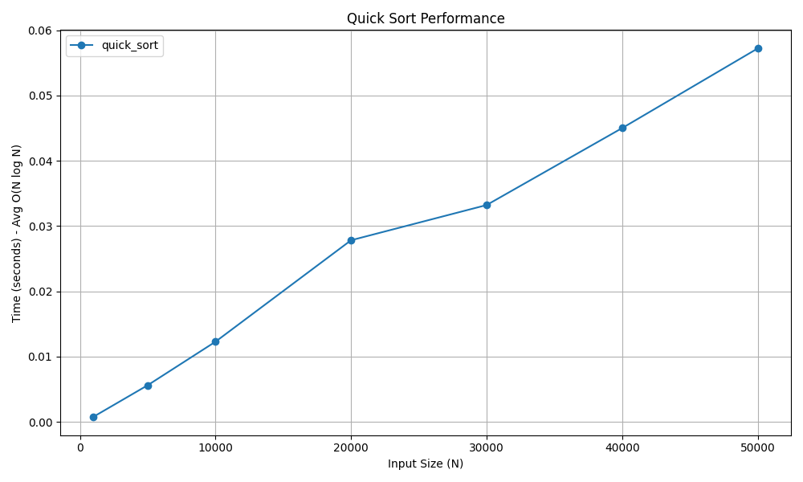

# Quick Sort

## 📝 Problem Statement
The objective is to sort an array efficiently in-place by selecting a 'pivot' element and partitioning the other elements into two sub-arrays according to whether they are less than or greater than the pivot.

## 💡 Algorithm / Approach
Quick Sort is a Divide and Conquer algorithm. It picks an element as a pivot and partitions the given array around the picked pivot. There are many different versions of quickSort that pick pivot in different ways (first element, last element, random, or median). This implementation uses the last element as the pivot.

## 📜 Pseudocode
```text
Procedure QuickSort(arr, low, high)
    If low < high Then
        pivot_index = Partition(arr, low, high)
        QuickSort(arr, low, pivot_index - 1)
        QuickSort(arr, pivot_index + 1, high)
    End If
End Procedure

Procedure Partition(arr, low, high)
    pivot = arr[high]
    i = low - 1
    
    For j = low to high - 1
        If arr[j] <= pivot Then
            i = i + 1
            Swap arr[i] and arr[j]
        End If
    End For
    
    Swap arr[i + 1] and arr[high]
    Return i + 1
End Procedure
```

