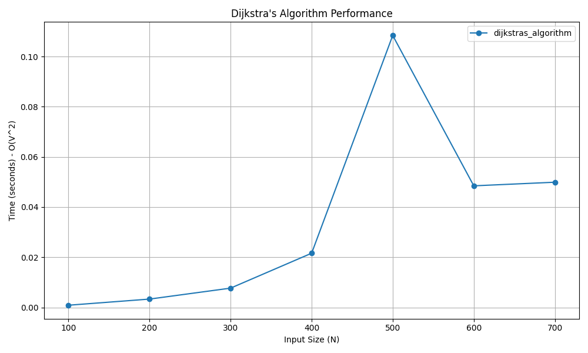

# Dijkstra's Single-Source Shortest Path Algorithm

## 📝 Problem Statement
Given a graph and a source vertex, find the shortest paths from the source vertex to all other vertices in the graph. The graph can be directed or undirected, but it must not contain any negative weight edges.

## 💡 Algorithm / Approach
Dijkstra's algorithm uses the **Greedy Method**. 
1. Maintain an array `dist` to store the shortest distance from the source to every other vertex, initialized to infinity (except the source, which is 0).
2. Maintain a boolean array `spt_set` to track vertices that have been permanently processed.
3. At each step, greedily select the unprocessed vertex `u` with the minimum `dist` value.
4. Mark `u` as processed.
5. Relax all adjacent vertices of `u`: If the path through `u` to an adjacent vertex `v` is shorter than the current `dist[v]`, update `dist[v]`.
6. Repeat until all reachable vertices are processed.

## 📜 Pseudocode
```text
Procedure Dijkstra(graph, src)
    V = length(graph)
    Initialize dist[] of size V to infinity
    Initialize spt_set[] of size V to False
    
    dist[src] = 0
    
    For count = 0 to V - 1
        u = vertex with minimum dist[] value not in spt_set
        spt_set[u] = True
        
        For v = 0 to V - 1
            If not spt_set[v] and graph[u][v] > 0 Then
                If dist[u] + graph[u][v] < dist[v] Then
                    dist[v] = dist[u] + graph[u][v]
                End If
            End If
        End For
    End For
    
    Return dist
End Procedure


```
