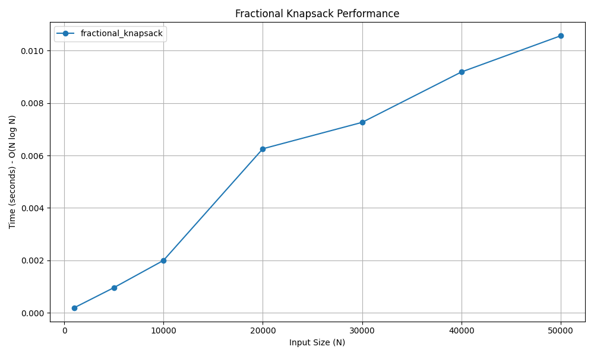

# Fractional Knapsack Problem

## 📝 Problem Statement
Given a set of items, each with a weight and a value, determine the maximum value that can be accommodated in a knapsack of a fixed capacity. Unlike the 0/1 Knapsack problem, items can be broken into smaller fractions.

## 💡 Algorithm / Approach
The Fractional Knapsack problem is solved using the **Greedy Method**. 
1. Calculate the value-to-weight ratio for each item.
2. Sort all items in descending order based on this ratio.
3. Iterate through the sorted items, adding whole items to the knapsack until the remaining capacity is less than the weight of the next item.
4. For the final item that exceeds the remaining capacity, take a fraction of it that exactly fills the knapsack.

## 📜 Pseudocode
```text
Procedure FractionalKnapsack(items, capacity)
    For each item in items
        item.ratio = item.value / item.weight
    End For
    
    Sort items in descending order of ratio
    
    total_value = 0
    For each item in items
        If capacity >= item.weight Then
            capacity = capacity - item.weight
            total_value = total_value + item.value
        Else
            total_value = total_value + (item.value * (capacity / item.weight))
            Break
        End If
    End For
    
    Return total_value
End Procedure


```
