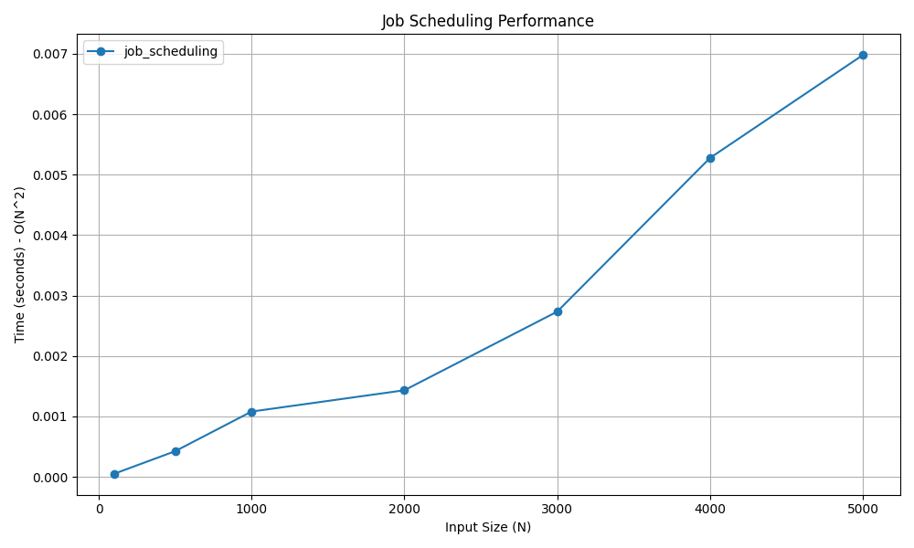

# Job Scheduling with Deadlines

## 📝 Problem Statement
Given a set of jobs where every job has a specific deadline and associated profit if the job is finished before the deadline, find the maximum profit. It is assumed that every job takes exactly one unit of time to complete, and only one job can be scheduled at a time.

## 💡 Algorithm / Approach
This problem is solved using the **Greedy Method** by prioritizing jobs with the highest profit.
1. Sort all jobs in descending order of their profit.
2. Determine the maximum deadline among all jobs to create a time-slot tracking array.
3. Iterate through the sorted jobs. For each job, try to schedule it in the latest possible free time slot that is on or before its deadline.
4. If a slot is found, mark it as occupied and add the job's profit to the total.

## 📜 Pseudocode
```text
Procedure JobScheduling(jobs)
    Sort jobs by profit in descending order
    max_deadline = maximum deadline across all jobs
    Initialize slots array of size (max_deadline + 1) to Empty
    
    total_profit = 0
    
    For each job in jobs
        For j = min(max_deadline, job.deadline) down to 1
            If slots[j] is Empty Then
                slots[j] = job.id
                total_profit = total_profit + job.profit
                Break
            End If
        End For
    End For
    
    Return total_profit
End Procedure


```
