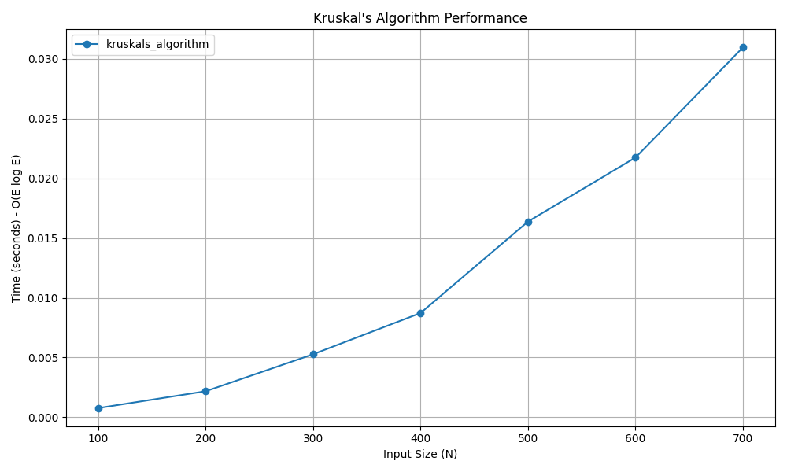

# Kruskal's Minimum Spanning Tree (MST) Algorithm

## 📝 Problem Statement
Given a connected, undirected, and weighted graph, find a Minimum Spanning Tree (MST). An MST is a subgraph that connects all the vertices together without any cycles and minimizes the total edge weight.

## 💡 Algorithm / Approach
Kruskal's algorithm uses the **Greedy Method** combined with a **Disjoint Set (Union-Find)** data structure.
1. Sort all the edges in the graph in non-decreasing order of their weight.
2. Pick the smallest edge. Check if it forms a cycle with the spanning tree formed so far using the Union-Find `find` operation.
3. If a cycle is not formed, include this edge using the `union` operation. Otherwise, discard it.
4. Repeat step 2 until there are exactly V-1 edges in the spanning tree.

## 📜 Pseudocode
```text
Procedure KruskalMST(edges, V)
    Sort edges in ascending order by weight
    Initialize Disjoint Set for V elements (parent array, rank array)
    
    mst_weight = 0
    edges_included = 0
    i = 0
    
    While edges_included < V - 1 and i < length(edges)
        u, v, weight = edges[i]
        i = i + 1
        
        x = Find(u)
        y = Find(v)
        
        If x != y Then
            edges_included = edges_included + 1
            mst_weight = mst_weight + weight
            Union(x, y)
        End If
    End While
    
    Return mst_weight
End Procedure


```
