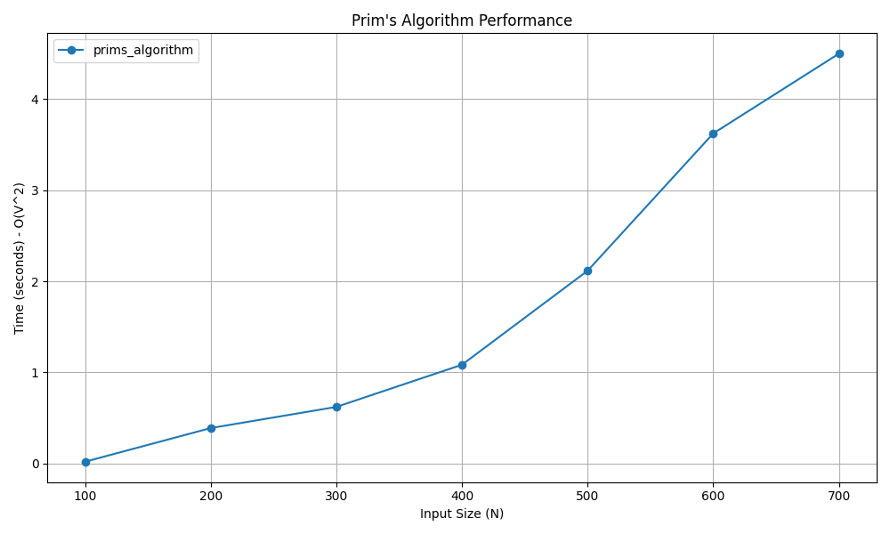

# Prim's Minimum Spanning Tree (MST) Algorithm

## 📝 Problem Statement
Given a connected, undirected, and weighted graph, find a Minimum Spanning Tree (MST). An MST is a subgraph that connects all the vertices together without any cycles and with the minimum possible total edge weight.

## 💡 Algorithm / Approach
Prim's algorithm uses the **Greedy Method** to grow the spanning tree from a starting position.
1. Maintain two sets of vertices: one containing vertices already included in the MST, and the other containing vertices not yet included.
2. Start with an arbitrary vertex and add it to the MST set.
3. At each step, consider all edges that connect the MST set to the non-MST set. 
4. Greedily pick the minimum weight edge from these connecting edges and add the new vertex to the MST set.
5. Repeat this process until all vertices are included in the MST.

## 📜 Pseudocode
```text
Procedure PrimMST(graph)
    Initialize selected array of size V to False
    selected[0] = True
    no_edge = 0
    mst_weight = 0
    
    While no_edge < V - 1
        minimum = infinity
        u = 0, v = 0
        
        For i = 0 to V - 1
            If selected[i] is True Then
                For j = 0 to V - 1
                    If selected[j] is False and graph[i][j] > 0 Then
                        If minimum > graph[i][j] Then
                            minimum = graph[i][j]
                            u = i
                            v = j
                        End If
                    End If
                End For
            End If
        End For
        
        selected[v] = True
        mst_weight = mst_weight + graph[u][v]
        no_edge = no_edge + 1
    End While
    
    Return mst_weight
End Procedure


```
