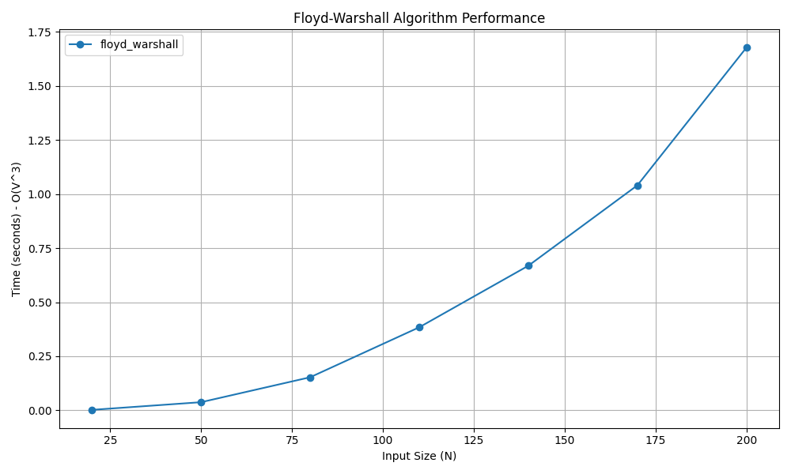

# Floyd-Warshall (All-Pairs Shortest Path) Algorithm

## 📝 Problem Statement
Given a directed or undirected weighted graph, find the shortest paths between every pair of vertices. The graph may contain negative weight edges, but it must not contain any negative weight cycles.

## 💡 Algorithm / Approach
The Floyd-Warshall algorithm uses **Dynamic Programming** to solve the All-Pairs Shortest Path problem. 
1. Initialize a 2D distance matrix `dist` that represents the shortest paths between all pairs of vertices. Initially, it is a copy of the graph's adjacency matrix.
2. The algorithm considers each vertex `k` as an intermediate point between a source vertex `i` and a destination vertex `j`.
3. For every pair `(i, j)`, check if going through the intermediate vertex `k` offers a shorter path than the direct edge or previously found path.
4. The recurrence relation is: `dist[i][j] = min(dist[i][j], dist[i][k] + dist[k][j])`.
5. Repeat this iteratively for all vertices as intermediate points.

## 📜 Pseudocode
```text
Procedure FloydWarshall(graph)
    V = length(graph)
    Initialize dist matrix same as graph
    
    For k = 0 to V - 1
        For i = 0 to V - 1
            For j = 0 to V - 1
                If dist[i][k] + dist[k][j] < dist[i][j] Then
                    dist[i][j] = dist[i][k] + dist[k][j]
                End If
            End For
        End For
    End For
    
    Return dist
End Procedure

``` 
