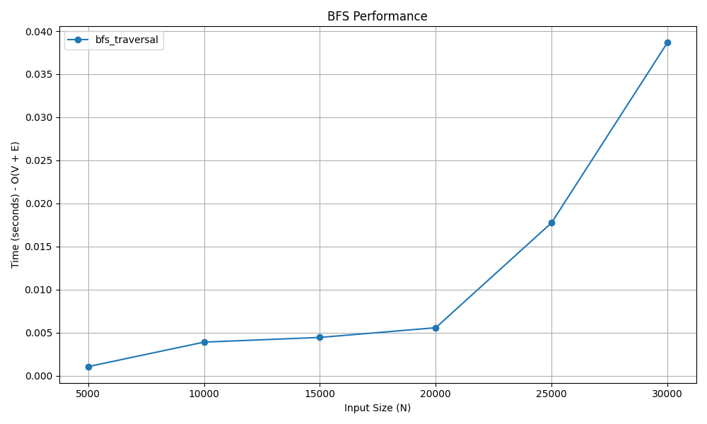

# Breadth-First Search (BFS)

## 📝 Problem Statement
Given a graph and a starting vertex, traverse the graph level by level. Explore all the neighboring vertices at the present depth prior to moving on to the vertices at the next depth level.

## 💡 Algorithm / Approach
BFS utilizes a **Queue** (First-In-First-Out) data structure to keep track of the vertices to visit next.
1. Start by pushing the starting vertex into the queue and marking it as visited.
2. While the queue is not empty:
   * Dequeue a vertex from the front of the queue.
   * Iterate through all of its unvisited adjacent vertices.
   * Mark each unvisited adjacent vertex as visited and enqueue it.
3. This guarantees that all nodes at distance $d$ from the source are processed before any nodes at distance $d+1$.

## 📜 Pseudocode
```text
Procedure BFS(adj_list, start_node, V)
    Initialize visited array of size V to False
    Initialize a Queue Q
    
    visited[start_node] = True
    Enqueue start_node into Q
    
    While Q is not empty
        current = Dequeue(Q)
        Print or Store current
        
        For each neighbor in adj_list[current]
            If not visited[neighbor] Then
                visited[neighbor] = True
                Enqueue neighbor into Q
            End If
        End For
    End While
End Procedure

```
