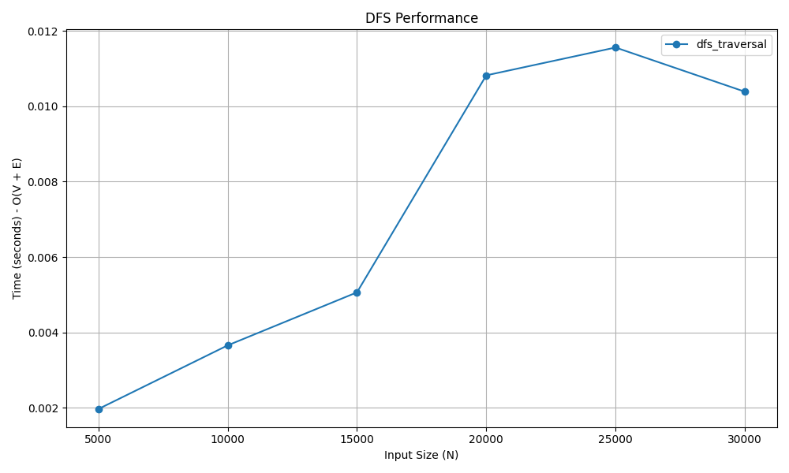

# Depth-First Search (DFS)

## 📝 Problem Statement
Given a graph and a starting vertex, traverse the graph by exploring as far as possible along each branch before backtracking. 

## 💡 Algorithm / Approach
DFS utilizes a **Stack** data structure (often implemented implicitly via the system's call stack using recursion) to keep track of the path.
1. Start at the root (or any arbitrary node) and mark it as visited.
2. Pick an adjacent unvisited node, mark it as visited, and recursively call the DFS function on it.
3. If the current node has no unvisited adjacent nodes, backtrack to the previous node and explore its remaining unvisited neighbors.
4. Repeat this process until all reachable nodes have been visited.

## 📜 Pseudocode
```text
Procedure DFS(adj_list, V, start_node)
    Initialize visited array of size V to False
    Call DFSRecursive(adj_list, visited, start_node)
End Procedure

Procedure DFSRecursive(adj_list, visited, node)
    visited[node] = True
    Print or Store node
    
    For each neighbor in adj_list[node]
        If not visited[neighbor] Then
            DFSRecursive(adj_list, visited, neighbor)
        End If
    End For
End Procedure

```
